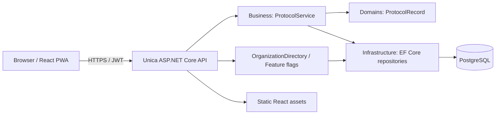

# Architettura implementata — prima vertical slice

## Confini e dipendenze
- `Comuni.Domains`: dominio puro, nessuna dipendenza EF o ASP.NET.
- `Comuni.Business`: interfacce di repository/directory e use case; dipende solo da Domains.
- `Comuni.Infrastructures`: PostgreSQL EF Core, query filters, repository e migrazioni.
- `Comuni.Api`: composition root, JWT, policies, endpoints REST OpenAPI, host per SPA.

## Flusso sicurezza
1. Middleware valida firma HS256, issuer, audience e lifetime.
2. Policy `Read` / `Write` verifica `organization_id` valido, `sub` e **membership attiva/ruolo nel database**. Il claim JWT `role` non viene utilizzato per i permessi.
3. `HttpCurrentOrganization` estrae organization solo dal Principal autenticato; `OrganizationRoleHandler` controlla `platform.organization_memberships`.
4. `ProtocolService` verifica `organization_modules` nel DB.
5. Repository esprime `organizationId` nella query e EF impone query filter; SaveChanges rifiuta mismatch tenant.
6. Frontend riceve il contesto `/api/v1/context` e mostra solo i moduli abilitati (non è un confine di sicurezza).

Il database è condiviso con schemi `platform` e `protocol`, incluse membership tenant-scoped (GUID, subject, role, is_active). Il bootstrap migra e semina due organization solo in ambiente Development. In produzione non c'è seed automatico. Le operazioni admin/gestione organization richiederanno accessi separati e audit dedicato.

## Audit transazionale — prima slice

La registrazione dei metadati Protocollo genera un `AuditEvent` in `Domains/Audit`; il `ProtocolService` associa actor e correlation dal contesto API verificato. Il repository salva `protocol.records` e `platform.audit_events` in **un'unica transazione EF/PostgreSQL**: se uno dei due salvataggi fallisce, non deve apparire un record isolato. Eventi senza contenuto documentale. La tabella ha filtri EF per organization e trigger anti-modifica per UPDATE/DELETE/TRUNCATE; non protegge da DBA superuser né offre prova crittografica, retention o endpoint di consultazione. ADR 0006.

## Confine trust OIDC (ADR 0007)

`AuthenticationConfiguration` è valutata all'avvio e fallisce chiusa. Solo Development/Testing possono scegliere `DevelopmentJwt` con HS256 locale; la Production richiede `Oidc`, Authority HTTPS e Audience. `JwtBearer` verifica access token RS256 tramite metadati OIDC e chiavi JWKS (con refresh in caso di rotazione chiavi). `sub` e `organization_id` restano claim validati dal provider; i ruoli sono ricavati dalle membership attive nel database. Il binding identity provider/organization in un onboarding amministrato non è ancora presente: issue #2 ancora aperta. Non esistono sessioni/login frontend o federazione SPID/CIE.
