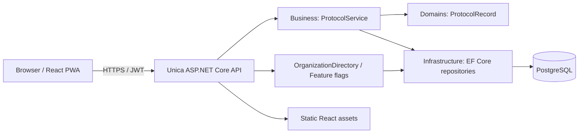

# Architettura implementata — prima vertical slice

## Confini e dipendenze
- `Comuni.Domains`: dominio puro, nessuna dipendenza EF o ASP.NET.
- `Comuni.Business`: interfacce di repository/directory e use case; dipende solo da Domains.
- `Comuni.Infrastructures`: PostgreSQL EF Core, query filters, repository e migrazioni.
- `Comuni.Api`: composition root, JWT, policies, endpoints REST OpenAPI, host per SPA.

## Flusso sicurezza
1. Middleware valida firma HS256, issuer, audience e lifetime.
2. Policy `Read` / `Write` verifica `organization_id` valido, `sub`, **organization esistente e non sospesa**, e **membership attiva/ruolo nel database**. Il claim JWT `role` non viene utilizzato per i permessi.
3. `HttpCurrentOrganization` estrae organization solo dal Principal autenticato; `OrganizationRoleHandler` controlla `platform.organization_memberships`.
4. `ProtocolService` verifica `organization_modules` nel DB.
5. Repository esprime `organizationId` nella query e EF impone query filter; SaveChanges rifiuta mismatch tenant.
6. Frontend riceve il contesto `/api/v1/context` e mostra solo i moduli abilitati (non è un confine di sicurezza).

La sospensione è persistita in `platform.organizations.is_suspended` (ADR 0008): un token valido non bypassa il blocco. La gestione amministrativa della sospensione non è ancora esposta e resta parte del lifecycle/Superadmin (#3/#10). Il database è condiviso con schemi `platform` e `protocol`, incluse membership tenant-scoped (GUID, subject, role, is_active). Il bootstrap migra e semina due organization solo in ambiente Development. In produzione non c'è seed automatico. Le operazioni admin/gestione organization richiederanno accessi separati e audit dedicato.

## Audit transazionale — prima slice

La registrazione dei metadati Protocollo genera un `AuditEvent` in `Domains/Audit`; il `ProtocolService` associa actor e correlation dal contesto API verificato. Il repository salva `protocol.records` e `platform.audit_events` in **un'unica transazione EF/PostgreSQL**: se uno dei due salvataggi fallisce, non deve apparire un record isolato. Eventi senza contenuto documentale. La tabella ha filtri EF per organization e trigger anti-modifica per UPDATE/DELETE/TRUNCATE; non protegge da DBA superuser né offre prova crittografica, retention o endpoint di consultazione. ADR 0006.

## Confine trust OIDC (ADR 0007)

`AuthenticationConfiguration` è valutata all'avvio e fallisce chiusa. Solo Development/Testing possono scegliere `DevelopmentJwt` con HS256 locale; la Production richiede `Oidc`, Authority HTTPS e Audience. `JwtBearer` verifica access token RS256 tramite metadati OIDC e chiavi JWKS (con refresh in caso di rotazione chiavi). `sub` e `organization_id` restano claim validati dal provider; i ruoli sono ricavati dalle membership attive nel database. Il binding identity provider/organization in un onboarding amministrato non è ancora presente: issue #2 ancora aperta. Non esistono sessioni/login frontend o federazione SPID/CIE.

## Moduli gestiti da Admin Comune (ADR 0009)

`ModuleAdministrationService` è un use case del Core: valida il nome del modulo installato e costruisce l'audit usando l'actor del JWT validato. `ModuleAdministrationRepository` usa EF scoped per organization; aggiorna `platform.organization_modules` e crea `platform.audit_events` in un'unica transazione PostgreSQL. La policy `Admin` è verificata dall'handler che controlla le membership del DB, oltre allo stato operativo del Comune. La SPA React espone l'area amministrativa soltanto ad Admin e rilegge il context server dopo ogni modifica; menu e API riflettono il nuovo flag. Eventuali modifiche da altri operatori richiedono un refresh; la gestione concorrenza distribuita e le dipendenze tra moduli sono future attività dell'epica #3.

## Protezioni HTTP incrementali (ADR 0010)

Il middleware di header opera **prima** di autenticazione e rifiuti, così che 401/403/429 ricevano le intestazioni di sicurezza. Il rate limiter globale ASP.NET Core è inserito soltanto nel ramo `/api`, **dopo** la validazione JWT e **prima** delle policy autorizzative: può partizionare richieste valide per Comune/operatore senza fidarsi dei claim prima della validazione. Il traffico anonimo è per IP socket. Health e PWA non sono soggetti a quota. Finestra e limite sono configurabili e validati all'avvio, nessuna infrastruttura distribuita aggiuntiva (vedere ADR 0010 e #15).

## PostgreSQL: role runtime vs owner delle migrazioni (ADR 0011)

La connessione `ConnectionStrings__Default` per l'API di **produzione** viene provisionata dal Terraform con `comuni_app_runtime`, un login PostgreSQL non owner. Il provisioning SQL esplicito avviene **dopo** le migrazioni EF applicate dal ruolo amministrativo, prima del rollout app. Gli adapter EF continuano a usare un'unica istanza logica di PostgreSQL e la stessa API; la barriera dei privilegi DB riduce l'impatto di un errore applicativo e la RLS transaction-local dell'ADR 0012 filtra le righe sotto l'account runtime non owner. La GUC unsigned dell'ADR 0012 è stata sostituita dalle asserzioni HMAC dell'ADR 0013; vedere #5/#6 per security review e migrazione remota.

## RLS e ciclo di vita transazione per richiesta — ADR 0012

Il middleware API legge l'organization **soltanto** dal Principal JWT già validato. In una transazione EF (creata dopo l'autenticazione, prima delle policy) esegue il comando parametrizzato `set_config('comuni.organization_id', tenant, true)`: il valore è `SET LOCAL`, visibile solo nella transazione che contiene le query EF. Autorizzazione, query del Core/Protocollo e scritture audit partecipano alla **stessa** transazione; i repository evitano nested transaction e mantengono commit atomico se invocati fuori dall'HTTP. Le richieste negate non eseguono commit. Cinque tabelle sono sotto RLS; `platform.audit_events` rimane INSERT-only per l'account runtime. Lo scope e il ciclo di vita del pool sono testati con SQL diretto su PostgreSQL 17. Il bypass owner/superuser e la GUC custom modificabile impediscono di presentare questo meccanismo come confine inviolabile sotto SQL injection: la #5 rimane aperta.

## Verifica RLS delle prove firmate (ADR 0013)

Il ruolo applicativo condiviso non firma asserzioni tenant: la singola API .NET le firma con HMAC-SHA256, ottenendo la chiave dal Key Vault. La transazione salva solo la prova firmata in `comuni.tenant_assertion`. Le policy RLS chiamano la funzione PostgreSQL `platform.verified_tenant_id()` `SECURITY DEFINER`, la quale legge la chiave privata dalla tabella `tenant_proof_secret` (non accessibile a `comuni_app_runtime`), verifica HMAC e scadenza, poi restituisce UUID o NULL. Il solo cambio di `comuni.organization_id` non modifica più l'identità. Nessun nuovo servizio, database o frontend: migrazione 0006, bootstrap del segreto condiviso e policy SQL aggiornate. Rimangono i rischi di un processo API compromesso, riuso di assertion catturate, superuser e disponibilità durante la rotazione.
