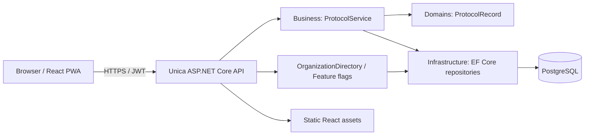

# Architettura implementata — prima vertical slice

## Confini e dipendenze
- `Comuni.Domains`: dominio puro, nessuna dipendenza EF o ASP.NET.
- `Comuni.Business`: interfacce di repository/directory e use case; dipende solo da Domains.
- `Comuni.Infrastructures`: PostgreSQL EF Core, query filters, repository e migrazioni.
- `Comuni.Api`: composition root, JWT, policies, endpoints REST OpenAPI, host per SPA.

## Flusso sicurezza
1. Middleware valida firma HS256, issuer, audience e lifetime.
2. Policy `Read` / `Write` verifica `organization_id` valido, `sub`, **organization esistente e non sospesa**, e **membership attiva/ruolo nel database**. Il claim JWT `role` non viene utilizzato per i permessi.
3. `HttpCurrentOrganization` estrae organization solo dal Principal autenticato; `OrganizationRoleHandler` controlla `platform.organization_memberships`.
4. `ProtocolService` verifica `organization_modules` nel DB.
5. Repository esprime `organizationId` nella query e EF impone query filter; SaveChanges rifiuta mismatch tenant.
6. Frontend riceve il contesto `/api/v1/context` e mostra solo i moduli abilitati (non è un confine di sicurezza).

La sospensione è persistita in `platform.organizations.is_suspended` (ADR 0008): un token valido non bypassa il blocco. La gestione amministrativa della sospensione non è ancora esposta e resta parte del lifecycle/Superadmin (#3/#10). Il database è condiviso con schemi `platform` e `protocol`, incluse membership tenant-scoped (GUID, subject, role, is_active). Il bootstrap migra e semina due organization solo in ambiente Development. In produzione non c'è seed automatico. Le operazioni admin/gestione organization richiederanno accessi separati e audit dedicato.

## Audit transazionale — prima slice

La registrazione dei metadati Protocollo genera un `AuditEvent` in `Domains/Audit`; il `ProtocolService` associa actor e correlation dal contesto API verificato. Il repository salva `protocol.records` e `platform.audit_events` in **un'unica transazione EF/PostgreSQL**: se uno dei due salvataggi fallisce, non deve apparire un record isolato. Eventi senza contenuto documentale. La tabella ha filtri EF per organization e trigger anti-modifica per UPDATE/DELETE/TRUNCATE; non protegge da DBA superuser né offre prova crittografica, retention o endpoint di consultazione. ADR 0006.

## Confine trust OIDC (ADR 0007)

`AuthenticationConfiguration` è valutata all'avvio e fallisce chiusa. Solo Development/Testing possono scegliere `DevelopmentJwt` con HS256 locale; la Production richiede `Oidc`, Authority HTTPS e Audience. `JwtBearer` verifica access token RS256 tramite metadati OIDC e chiavi JWKS (con refresh in caso di rotazione chiavi). `sub` e `organization_id` restano claim validati dal provider; i ruoli sono ricavati dalle membership attive nel database. Il binding identity provider/organization in un onboarding amministrato non è ancora presente: issue #2 ancora aperta. Non esistono sessioni/login frontend o federazione SPID/CIE.

## Moduli gestiti da Admin Comune (ADR 0009)

`ModuleAdministrationService` è un use case del Core: valida il nome del modulo installato e costruisce l'audit usando l'actor del JWT validato. `ModuleAdministrationRepository` usa EF scoped per organization; aggiorna `platform.organization_modules` e crea `platform.audit_events` in un'unica transazione PostgreSQL. La policy `Admin` è verificata dall'handler che controlla le membership del DB, oltre allo stato operativo del Comune. La SPA React espone l'area amministrativa soltanto ad Admin e rilegge il context server dopo ogni modifica; menu e API riflettono il nuovo flag. Eventuali modifiche da altri operatori richiedono un refresh; la gestione concorrenza distribuita e le dipendenze tra moduli sono future attività dell'epica #3.

## Protezioni HTTP incrementali (ADR 0010)

Il middleware di header opera **prima** di autenticazione e rifiuti, così che 401/403/429 ricevano le intestazioni di sicurezza. Il rate limiter globale ASP.NET Core è inserito soltanto nel ramo `/api`, **dopo** la validazione JWT e **prima** delle policy autorizzative: può partizionare richieste valide per Comune/operatore senza fidarsi dei claim prima della validazione. Il traffico anonimo è per IP socket. Health e PWA non sono soggetti a quota. Finestra e limite sono configurabili e validati all'avvio, nessuna infrastruttura distribuita aggiuntiva (vedere ADR 0010 e #15).

## PostgreSQL: role runtime vs owner delle migrazioni (ADR 0011)

La connessione `ConnectionStrings__Default` per l'API di **produzione** viene provisionata dal Terraform con `comuni_app_runtime`, un login PostgreSQL non owner. Il provisioning SQL esplicito avviene **dopo** le migrazioni EF applicate dal ruolo amministrativo, prima del rollout app. Gli adapter EF continuano a usare un'unica istanza logica di PostgreSQL e la stessa API; la barriera dei privilegi DB riduce l'impatto di un errore applicativo e la RLS transaction-local dell'ADR 0012 filtra le righe sotto l'account runtime non owner. La GUC unsigned dell'ADR 0012 è stata sostituita dalle asserzioni HMAC dell'ADR 0013; vedere #5/#6 per security review e migrazione remota.

## RLS e ciclo di vita transazione per richiesta — ADR 0012

Il middleware API legge l'organization **soltanto** dal Principal JWT già validato. In una transazione EF (creata dopo l'autenticazione, prima delle policy) esegue il comando parametrizzato `set_config('comuni.organization_id', tenant, true)`: il valore è `SET LOCAL`, visibile solo nella transazione che contiene le query EF. Autorizzazione, query del Core/Protocollo e scritture audit partecipano alla **stessa** transazione; i repository evitano nested transaction e mantengono commit atomico se invocati fuori dall'HTTP. Le richieste negate non eseguono commit. Cinque tabelle sono sotto RLS; `platform.audit_events` rimane INSERT-only per l'account runtime. Lo scope e il ciclo di vita del pool sono testati con SQL diretto su PostgreSQL 17. Il bypass owner/superuser e la GUC custom modificabile impediscono di presentare questo meccanismo come confine inviolabile sotto SQL injection: la #5 rimane aperta.

## Verifica RLS delle prove firmate (ADR 0013)

Il ruolo applicativo condiviso non firma asserzioni tenant: la singola API .NET le firma con HMAC-SHA256, ottenendo la chiave dal Key Vault. La transazione salva solo la prova firmata in `comuni.tenant_assertion`. Le policy RLS chiamano la funzione PostgreSQL `platform.verified_tenant_id()` `SECURITY DEFINER`, la quale legge la chiave privata dalla tabella `tenant_proof_secret` (non accessibile a `comuni_app_runtime`), verifica HMAC e scadenza, poi restituisce UUID o NULL. Il solo cambio di `comuni.organization_id` non modifica più l'identità. Nessun nuovo servizio, database o frontend: migrazione 0006, bootstrap del segreto condiviso e policy SQL aggiornate. Rimangono i rischi di un processo API compromesso, riuso di assertion catturate, superuser e disponibilità durante la rotazione.

## Boundary Key Vault / Terraform per la HMAC del tenant (ADR 0015)

La chiave HMAC viene creata e ruotata esclusivamente mediante un workflow operativo esterno, approvato: **Terraform non legge né scrive il valore** e fornisce a Container Apps solo un riferimento versionless al secret. Il `removed` block con `destroy=false` tutela le installazioni che precedentemente avevano il secret nello state. La CI impedisce regressioni del contratto e verifica il preflight con metadata-only. L'ordine Key Vault → DB staging → nuova revisione API → verifica → revoca non è ancora orchestrato né collaudato in Azure. Vedere #19 e #6.

## Pinning del secret HMAC RLS in Container Apps — ADR 0016

Il deploy usa una **versioned Key Vault URI** nella secret reference di Azure Container Apps, senza esporre la chiave nella configurazione Terraform. La coppia `tenant_proof_key_id` (ID logico nel verifier PostgreSQL) e `tenant_proof_secret_version` (versione immutabile della risorsa Key Vault) appartiene al piano di rilascio. Prima di plan/apply un controllo `az keyvault secret list-versions` verifica solo enabled per quella versione; il valore è risolto esclusivamente dalla managed identity applicativa. La CI non testa un deployment live e `revision_mode Single` non supporta una fase di validazione parallela delle nuove repliche: vedere #19 e #6.

## Canary staging di revisioni Container Apps (ADR 0017)

La stessa singola Container App API/React passa alla modalità `Multiple` con revision suffix immutabile per commit e **nessun inoltro automatico del traffico pubblico alla latest**. Lo stable revision suffix è input esplicito e la secret HMAC precedente conserva il proprio nome/Key Vault version; la candidata usa un nome nuovo di app-scoped secret e una versione pin distinta. Un gate Python su Terraform plan JSON controlla le modifiche ammesse prima di apply, per evitare che Terraform alteri la stable o altre risorse critiche. La parte di *promotion* e relativi smoke test non è implementata: #19/#6.

## Gate metadata-only dopo lo staging ACA (ADR 0018)

Il workflow approvato di release conserva il blocco anti-distruzione di Terraform e, dopo apply, verifica in Azure le revisioni reali senza alterare il 100%/0% del traffico. Il verificatore legge stato/routing/identità configurata con Azure CLI, mai valori Key Vault, e controlla immagine SHA + key ID/secret reference della candidata. La verifica è uno step obbligatorio prima di pianificare smoke HTTP/RLS e promozione, che restano fuori scope. Un fallimento non implica rollback automatico, dato che lo stage deve essere già a 0% di traffico.

## Canary label e smoke read-only su candidata (ADR 0019)

La regola ACA del template candidato pesa **0%** ma ottiene `label = candidate_revision_suffix`, esponendo un FQDN di revisione distinto dall'URL stabile dell'app. Il piano Terraform e il verifier live verificano il binding; la label non è un'API diversa né un nuovo servizio. Un tool di smoke read-only permette, quando un IdP reale sarà configurato, di interrogare **la stessa API** tramite la label con due token OIDC per due Comuni sintetici, verificando autorizzazione e accesso ai metadati Protocollo. Nessun token è incorporato nell'immagine o nella pipeline CI, e lo smoke non promuove la candidata. #19/#6 conservano il controllo di promozione, rollback e collaudo Azure.

## Client browser PKCE e API unica (ADR 0020)

Un **solo** frontend React effettua OAuth2 Authorization Code + PKCE S256 verso un provider OIDC configurato dinamicamente dall'unica API ASP.NET (`GET /api/v1/auth/browser`). In `Production` la UI **non mostra** il campo JWT manuale; la API continua a usare `JwtBearer` RS256/JWKS e le membership PostgreSQL, senza nuova app, servizio o database. Stato PKCE temporaneo/sessionStorage, access token in RAM (nessun refresh token); callback ripulita prima dello scambio. L'issuer reale deve essere registrato esternamente e il browser client deve poter usare CORS sul token endpoint. Il modello browser conserva rischio XSS; un BFF/cookie HttpOnly nella stessa API rimane opzione preferibile da valutare prima del go-live.

## Provisioning amministrativo membership Reader/Officer (ADR 0021)

Nel Core `MembershipAdministrationService` implementa la validazione di tenant/ruolo/soggetto e l'attribuzione server-side degli eventi di audit; `MembershipAdministrationRepository` effettua UPSERT/UPDATE parametrizzati su `platform.organization_memberships` e insert append-only `platform.audit_events` nella stessa transazione PostgreSQL (anche quando la transazione è aperta dal middleware JWT/RLS). L'API unica pubblica `GET/PUT /api/v1/admin/memberships` dietro policy Admin, e lo stesso frontend React ospita la gestione nell'area Amministrazione. L'IdP non viene mutato né invocato. La migrazione 0008 aggiunge policy RLS restrittive per proibire all'account runtime la scrittura di ruoli Admin anche in presenza di SQL injection; il ruolo runtime dispone di grant colonnari soltanto. Gestione Admin/last-admin e identity binding sono incrementi distinti (#2/#3/#10).

## Membership vincolata a issuer OIDC (ADR 0022)

Il confine auth separa due modalità. `Oidc` richiede che `issuer + subject + organization_id` provenienti dal Principal JWT validato corrispondano alla membership persistita con `identity_issuer` non-NULL (migrazione 0009). `DevelopmentJwt` consente per demo le righe senza issuer, ma non si può attivare in Production. `OrganizationRoleHandler` e `/api/v1/context` interrogano la stessa `OrganizationMembershipStore` con `iss` autenticato; la policy PostgreSQL RLS rimane tenant-scoped. Il service Admin passa l'issuer del JWT verificato al repository, e il repository usa un INSERT con binding immutabile e verifica di conflitto su righe legacy; spostare una riga tra provider richiede autorizzazione operativa separata. La UI mostra issuer in sola lettura; una sola API, un React e lo stesso PostgreSQL.

## Boundary iniziale per l'Admin OIDC (ADR 0025 / #31)

Quando non esiste ancora un Admin di Comune, non viene introdotta una scorciatoia API/SPA né un secondo identity service. Un runner owner con change ticket verificato fuori dal sistema aggiunge **una sola membership Admin** con `identity_issuer`+`subject` esatti e audit atomico nello stesso PostgreSQL, serializzando la riga organization. Il login runtime continua a non poter scrivere Admin. Ogni operazione successiva passa per la stessa API e membership RLS esistenti; il provider esterno e la console Superadmin rimangono attività distinte.

## Creazione isolata dei Comuni — bootstrap offline (ADR 0026 / #32)

Il Core non espone ancora la creazione cross-tenant all'API: un comando `psql` eseguibile **solo con owner dello schema** crea una organization e un flag `protocol=FALSE` con un evento di audit in un'unica transazione, acquisendo un advisory lock per UUID. Le membership sono vuote; il contesto tenant e i permessi continuano a essere imposti da JWT verificato, membership PostgreSQL, RLS firmata e stato organization, non da un parametro client. Il bootstrap del primo Admin OIDC (ADR 0025) è **una operazione distinta** subordinata alla verifica esterna della persona. La console Superadmin, l'approvazione real-time e il lifecycle completo di Comuni rimangono #3/#10; una sola API .NET, un React e un PostgreSQL.

## Lifecycle sicurezza Comune — stato sospeso (#33 / ADR 0027)

Il Core dispone già di `is_suspended` e del controllo authorization server-side per richiesta (ADR 0008), ma l'operatore in possesso del change approvato deve applicare le transizioni **solo con un runner owner PostgreSQL offline**. Lo script gestisce un singolo tenant esistente e scrive `platform.organization.suspended` o `platform.organization.reactivated` atomico e una sola volta per cambio di stato, serializzando `SELECT FOR UPDATE`. Non introduce una seconda API, un frontend separato, tabelle nuove o un ruolo multi-tenant accessibile dalla SPA; l'Admin comunale non può gestire l'accesso degli altri Comuni. I flag moduli e le membership rimangono invariati. La console Superadmin e la gestione platform RBAC, revoca OIDC e audit regolamentare richiedono incrementi successivi nelle epiche #3/#4/#10.

## Confine OIDC identità piattaforma, senza impersonificazione (#34 / ADR 0028)

Una nuova policy `PlatformOperator` è **separata** dalle policy `Read/Write/Admin` basate su organization. La piattaforma accetta un JWT OIDC RS256 con `iss`+`sub` validi e senza alcun `organization_id` solo per una risposta minimale `GET /api/v1/platform/session`. Lo stato attivo si legge tramite funzione booleana PostgreSQL `SECURITY DEFINER`, non da un claim JWT o dalle membership comunali. L'app runtime non ha permessi di lettura del roster platform. Token comunali con organization claim non passano la policy platform; token platform non passano i vincoli tenant. **Nessuna operazione cross-tenant è esposta** in questa slice. L'area UI Superadmin, l'approvazione degli operatori, il catalogo globale e l'impersonificazione sono ancora requisiti aperti.

## Operator lifecycle e audit globale — confine platform (#35 / ADR 0029)

Dopo la verifica OIDC del `PlatformOperatorHandler` (ADR 0028), lo stato di un Superadmin è una riga persistita `platform.platform_operators` disgiunta da membership tenant. La sola mutation consentita in questa slice viene dall'owner PostgreSQL tramite `scripts/postgres/manage-platform-operator.sql`, **non** da SPA, Admin Comune o API. Un lock advisory su `iss+sub` protegge il primo inserimento, poi una row lock le revoche/riattivazioni; ogni transizione scrive **nello stesso commit** l'evento `platform.operator.enrolled/revoked/reactivated` nel nuovo audit globale `platform.platform_operator_audit_events` privo di `organization_id`. La correlazione usa un `operator_id` UUID casuale non ricavabile con un semplice dizionario dal subject. I trigger PostgreSQL impediscono UPDATE/DELETE/TRUNCATE ordinari, ma il proprietario dello schema resta amministrativamente privilegiato. L'unica API, l'unica React PWA e l'unico PostgreSQL non cambiano. La futura console Superadmin richiede altro lavoro per RBAC, audit delle consultazioni, approvazioni reali e impersonificazione.

## Superadmin nella PWA unica: prima area read-only (#36 / ADR 0030)

La stessa React SPA distingue **esclusivamente attraverso risposte backend** il contesto comunale (JWT con `organization_id`, membership attiva e policy Read) e la sessione piattaforma (JWT OIDC senza organization claim, riga `iss+sub` attiva in `platform.platform_operators` e policy PlatformOperator). All'accesso OIDC, la PWA verifica entrambi i contratti; ammette solo uno dei due, negando sia assenza sia ambiguità. I ruoli non sono decodificati dai token; la variante `DevelopmentJwt` non invoca la API platform. La vista `/platform` riutilizza sidebar, Brand, light/dark e IT/EN, senza aggiungere un secondo frontend o leggere informazioni su altri Comuni. Nessuna query globale, modifica, impersonificazione, rete extra o schema database.

La sessione piattaforma viene riverificata alla ripresa focus e prima della navigazione; logout/scadenza cancellano l'access token dalla RAM. Il percorso è visibile nel browser e **non** fornisce sicurezza: ciascuna richiesta reale resta protetta dall'autorizzazione .NET e dalla separazione PostgreSQL già realizzata. Questa prima UI non sostituisce un processo Superadmin completo né la verifica di MFA/IdP/Azure live.

## Primo inventario cross-organization: due principal SQL sullo stesso PostgreSQL (#37 / ADR 0031)

L'unica API .NET 10 serve **due percorsi PostgreSQL distinti**: il normale `ComuniDbContext` con `comuni_app_runtime` e RLS tenant proof firmata per richieste comunali; il nuovo `PlatformInventoryStore` Npgsql diretto con `comuni_platform_reader` per **soli metadati amministrativi globali**. Un database PostgreSQL, non un secondo servizio o schema di tenancy alternativo. La vista `platform.platform_organization_inventory` è owner-context con `security_barrier` e proietta soltanto `id,name,is_suspended,protocol_enabled`. Il ruolo platform ha SELECT soltanto sulla vista, non sulle tabelle base, i documenti, i ruoli comunali o il roster degli operatori. La normale app runtime non riceve accesso a questa vista o alla funzione globale; **non** è usato `IgnoreQueryFilters`.

La policy ASP.NET `PlatformOperator` valida JWT OIDC RS256 firmato, `iss+sub` DB attivi e nessun tenant claim; poi l'adapter platform verifica **nuovamente** che la coppia sia attiva in `platform.active_platform_operator_id`. In una transazione PostgreSQL separata esegue una query parametrizzata a keyset per massimo 25 entità e aggiunge un evento `platform.organizations.listed` nella tabella audit globale, con UUID anonimo stabile dell'operatore, correlation casuale e timestamp, senza PII. Il commit precede la risposta: un errore annulla lettura+audit. Il browser nella **stessa PWA** mostra lista e caricamento pagina successiva, senza modifica o impersonificazione. Credenziali platform e flag sono opt-in; il deployment Azure effettivo è fuori scope, e ogni eventuale secondo principal compromesso può enumerare i metadati di tutti gli enti. ADR 0031 documenta rischi e alternative rifiutate.

## #38 — Azure stage opt-in platform inventory tramite Key Vault (ADR 0032)

La stessa `azurerm_container_app.main` (API .NET 10 e SPA React) conserva ingress multi-revision e traffico **stable 100% / candidata 0%**; nessun secondo container, API o PostgreSQL. Il ruolo SQL `comuni_platform_reader` (#37) viene provisionato **offline, dopo le migrazioni**, tramite `scripts/postgres/provision-platform-read-role.sql` e controllato dal `verify-platform-read-role.sql` in una sessione owner READ ONLY. In Terraform `platform_inventory_enabled=false` è il default; se abilitato da un workflow manuale approved, l'unico dato aggiuntivo è l'**URI versionato** a `platform-inventory-connection` nel Key Vault esistente, con secret ACA app-scoped `pi-<primi 16 caratteri hex della versione>` (19 caratteri; URI versionato completo) e `ConnectionStrings__PlatformRead` referenziato tramite `secret_name`. Il valore della connessione è caricato/ruotato **fuori Terraform** e letto solo dalla managed identity del container. Il gate Terraform plan, i metadati Key Vault e i privilegi SQL sono verificati offline in CI; l'app in production resta disabilitata finché non si attiva esplicitamente una candidata approvata. La revisione stable resta invariata; gli effetti delle secret ACA già presenti sono protetti dal plan gate e richiedono retention/rollback pianificati prima di rotazioni successive. Nessuna integrazione Azure/IdP reale è stata verificata.

I nomi delle secret ACA del nuovo inventario sono limitati a 19 caratteri, per rispettare il limite Azure CLI di 20; l'URI di Key Vault mantiene la versione completa. Una collisione dei prefissi di 16 caratteri non viene risolta con sovrascrittura: il gate conserva la secret preesistente e blocca lo staging. Il naming delle secret versionate **RLS** è stato reso compatto a `tp-<16 hex>` nell'ADR 0033 / #39, mantenendo la versione completa nell'URI Key Vault; il deployment live e la rotazione verificata restano attività separate.

## #40 — Canary OIDC platform, controllo applicativo separato da RLS (ADR 0034)

La candidata Azure Container Apps già etichettata e verificata a **0% traffico ordinario** può essere sondata manualmente con un **terzo** access token, platform e senza tenant, a fianco dei due token comunali sintetici. Il tool Python indipendente `smoke-candidate-platform.py` verifica `PlatformOperator` prima del primo elenco global metadata e la **negazione incrociata** dei contesti; non crea una nuova API, un secondo frontend, un database o un servizio. Usa l'origin/label validator dello smoke tenant ADR 0019, non acquisisce token, non autorizza un Comune a impersonare, non modifica roster/audit/documenti/feature flags. Controlli bounded keyset pagination e schema di quattro campi minimizzano la superficie di lettura; il limit massimo di 20 pagine rende il tool un gate per un ambiente con dataset sintetico limitato, non un crawler di Comuni reali. La prova di audit/revoca SQL e IdP/MFA reale resta un passo esterno obbligatorio della #38.

## #41 — Audit di eventi recenti per Admin del proprio Comune, RLS firmata (ADR 0035)

La prima vista audit dell'area **Amministrazione** nella stessa React PWA legge `GET /api/v1/admin/audit`, protetto **solo** da membership Admin comunale attiva, non dalla policy platform Superadmin. Il nuovo confine Business `IOrganizationAuditReader` non gestisce mutation; `OrganizationAuditReader` usa il consueto `ComuniDbContext`/transaction HMAC per lo stesso `organization_id` derivato dal JWT firmato. Il doppio filtro EF sul Comune e policy PostgreSQL `platform.verified_tenant_id()` mantiene la separazione. Il runtime PostgreSQL `comuni_app_runtime` può ora leggere **cinque colonne** del tenant audit (`id,organization_id,action,resource_type,occurred_at`), ma non `actor_subject`, `resource_id`, `correlation_id` né roster/audit globale; nessun bypass RLS, `IgnoreQueryFilters` o connection owner.

L'API restituisce soltanto `id/action/resourceType/occurredAt` sugli **ultimi 25 eventi** ordinati in modo stabile per timestamp e ID, senza query/filtri/cursor/override tenant. Il frontend esegue la richiesta soltanto entrando come Admin comunale nell'area Amministrazione, con clear di eventuali metadata alla revalidazione, errore e logout, IT/EN e tema coerente. Questo non costituisce un modulo archivistico/audit di conservazione, né introduce CRUD o impersonificazione. Il provisioning role owner va riapplicato esplicitamente negli ambienti già migrati.

## #42 — Read + audit insert nello stesso tenant transaction (ADR 0036)

La route esistente `GET /api/v1/admin/audit` passa ora dal Business `MunicipalAuditService`, che genera `platform.audit.consulted` con l'attore e la correlazione del server, all'Infrastructure `OrganizationAuditReader.ListRecentAndRecordAsync`. Il repository rifiuta il mismatch di organization/risorsa/azione e **pretende una transaction SQL già aperta** dal middleware con tenant-proof HMAC. Prima legge max 25 metadata in ordine fisso, poi inserisce l'evento append-only e salva; il middleware fa commit solo se HTTP 2xx/3xx. Il frontend mostra una breve informativa IT/EN senza esporre attore/correlation/risorsa. Nessuna nuova API, servizio, database, query cross-org o privilegio SQL.

## #43 — Prima registrazione Comune separata dal Core runtime (ADR 0037)

Il Core multi-organization usa un unico PostgreSQL: `platform.organizations`, `platform.organization_modules`, `platform.organization_memberships` e audit condividono lo stesso database. La registrazione di un **nuovo** tenant è un comando PostgreSQL **owner-only offline** e non un endpoint API, per non attribuire privilegi globali al login `comuni_app_runtime` in attesa del workflow Superadmin autorizzato (#10). Il comando crea atomicamente una organization in stato **created (non operativa)** (membership vuote), la riga `protocol=false` e un evento audit. Un advisory lock transaction-local sul UUID serializza tentativi concorrenti; retry con ID, nome e ticket identici non riscrive stato/moduli/membership, mentre conflitti vengono rifiutati. Dopo il controllo esterno della registrazione, l'owner può eseguire separatamente il bootstrap iniziale del primo Admin OIDC (#31), senza modificare moduli.

Il nome non è un codice ISTAT né una garanzia di unicità legale; il workflow amministrativo esterno deve verificare identità e adesione dell'ente. Lo stato `created` distinto è introdotto dalla successiva #44/ADR 0038; il CRUD Superadmin resta in #3/#10.

## #44 — Lifecycle triplo con gate esplicito nel Core (ADR 0038)

La migration `202611150013_OrganizationActivationGate` aggiunge `is_activated` alla stessa tabella `platform.organizations`, con DEFAULT TRUE per tutti i Comuni **esistenti**, inclusi sospesi. Il constraint `is_activated OR NOT is_suspended` vieta una sospensione di un Comune mai attivato. Il dominio Organization ha `IsActivated` e `IsOperational`; la query `OrganizationDirectory.IsOperationalAsync` richiede `IsActivated && !IsSuspended` prima delle membership. Nessun nuovo DB, API, service, flag frontend o policy di bypass; la sicurezza rimane nel middleware JWT e nei controlli server/SQL.

Lo stato nuovo è **created** dopo la registrazione owner #43, con `protocol=false` e zero membership; può ricevere il primo Admin OIDC con bootstrap owner #31 ma tutti i token comunali rimangono 403 finché un change separato owner-only `activate-organization.sql` non lo rende **active** con audit atomico `platform.organization.activated`. Il comando richiede active Admin con issuer HTTPS verificato fuori dall'app, riga Protocollo disattivata e nessun servizio enabled; non concede accessi o abilita moduli di per sé. Solo da active gli operatori possono usare servizi abilitati; #33 può sospendere/riattivare ma rifiuta created.

L'inventario globale read-only usa ancora la stessa vista `platform.platform_organization_inventory` e gli stessi privilegi SQL separati: il compat boolean `is_suspended` è ora `o.is_suspended OR NOT o.is_activated`, quindi indica disponibilità **non operativa**, non il motivo. Ciò mantiene il payload minimo di quattro campi, senza cambiare i grants globali. La UI Superadmin non deve chiamare “Sospeso” un `created`. La migration Down è bloccata se esistono righe pending, per non renderle operative perdendo il gate.

## #45 — Proiezione lifecycle minimizzata Superadmin (ADR 0039)

La migration `202611160001_PlatformLifecycleInventory` estende, senza sostituire le quattro colonne originarie, la vista owner-context `platform.platform_organization_inventory` con `lifecycle_status`: `created` se non attivato, `suspended` se attivato e sospeso, `active` negli altri casi validi. La colonna deriva dal gate Core e non apre API di attivazione o una nuova connessione. Restano `security_barrier`, GRANT limitati a `comuni_platform_reader`, RLS firmata del runtime comunale e audit delle letture. L'API proietta cinque soli metadati e la PWA li verifica in modo fail-closed; i riferimenti a quattro colonne sopra descrivono il contratto precedente al #45.

## #57 — Fonte unica per i claim di identità autorizzata (ADR 0050)

La singola API .NET 10 continua a usare `AuthenticationConfiguration` per la verifica JwtBearer: HS256 solo nei test/demo locali, RS256/JWKS in OIDC hosted, con audience/issuer/lifetime obbligatori. Per evitare interpretazioni diverse della stessa identity autenticata, `VerifiedPrincipalIdentity` è il punto unico di lettura di `organization_id/sub/iss`. Per le operazioni comunali questi tre claim devono comparire **una volta esatta ciascuno**, con tenant UUID valido, subject entro i limiti di schema e issuer senza control characters; altrimenti `OrganizationRoleHandler` non interroga né directory né membership e il middleware non crea la transazione RLS firmata. `HttpCurrentOrganization`, `HttpCurrentActorContext`, rate limiting e route `/context` condividono la stessa validazione. Per l'operatore di piattaforma, la coppia `iss/sub` è univoca e manca **completamente** `organization_id`; la policy separata OIDC + PostgreSQL operatori resta obbligatoria e gli endpoint `/platform` non usano un tenant fittizio.

Nessuna parte del frontend, del body, di una query, del JWT role claim o di un header può selezionare il Comune. La soluzione non aggiunge database né cambia gli endpoint, mantiene la separazione schema `platform`/`protocol` e le protezioni RLS. Questo controllo di parsing è complementare alle verifiche di firma del token, issuer/sub bind, account revocation, audit e policy reali che rimangono aperti nelle epiche #2/#4/#5; la forma JSON originale non viene esaminata direttamente per le proprietà duplicate prima della costruzione di ClaimsPrincipal.

## #58 — Verifica di struttura JWT firmata al confine JwtBearer (ADR 0051)

L'autenticazione della singola API .NET 10 resta affidata a JwtBearer: token OIDC hosted RS256 e JWKS con issuer/audience/scadenza obbligatori, DevelopmentJwt HS256 confinato a Development/Testing. Poiché il parser può ridurre proprietà duplicate del **payload JSON JWT originale** prima di creare `ClaimsPrincipal`, `AuthenticationConfiguration.Apply` aggiunge un `OnTokenValidated` che esamina la serializzazione del `SecurityToken` **solo dopo** la validazione framework. Il parser bounded `JwtPayloadDuplicatePropertyGuard` verifica un oggetto JSON di massimo 64 KiB e profondità 32 con nomi unici per oggetto, anche in alberi annidati e con proprietà Unicode-escaped. Una collisione produce fallimento dell'autenticazione, prima di autorizzazione, apertura signed RLS o query tenant. Il controllo `VerifiedPrincipalIdentity` di ADR 0050 resta il secondo livello che esige singoli `organization_id/sub/iss` nel principal e confini platform tenantless.

Il controllo della struttura JWT non cambia API, frontend React, PostgreSQL, schemi, migrazioni o grant e non sostituisce enrollment reale OIDC, operazioni Admin, audit, Key Vault e sicurezza Azure. Un token firmato e structuralmente valido può comunque essere respinto dalla membership perché l'utente/Comune non è autorizzato. Non esiste una modalità di skip del controllo in produzione.

## #60 — Doppio controllo strutturale dei JWT validati (ADR 0052)

Nella singola API .NET 10 il trust boundary è sempre `JwtBearer` in configurazione OIDC/JWKS RS256 (hosted), HS256 DevelopmentJwt solo locale. Il callback `OnTokenValidated` di `AuthenticationConfiguration` non crea un principal alternativo: passa il solo `SecurityToken` **già verificato crittograficamente** a `JwtPayloadDuplicatePropertyGuard`, che ora rianalizza **entrambi i segmenti JSON JWS** (header JOSE e payload JWT), rifiuta nomi duplicati a qualunque profondità e applica limiti indipendenti di 8 KiB/64 KiB e depth 32. Gli algoritmi, le chiavi, la logica di validazione firma/issuer/audience e le due policy authorization municipal/platform rimangono invariati. `VerifiedPrincipalIdentity` (ADR0050) conserva la seconda validazione dell'identità unica nel `ClaimsPrincipal` non ambiguo.

La scelta di un algoritmo e chiave prima della firma resta responsabilità dell'handler standard con `ValidAlgorithms`; il parsing successivo dell'header serve soltanto a **negare** token ambigui, mai a influenzare `alg`/`kid` o riallocare ruoli. Nessun nuovo DB/API/frontend, nessun mutamento di RLS/feature flags; onboarding di un IdP reale e relative policy sono ancora #2/#5.
